<div align="center">

# NetForensiq

### Network & Packet Forensics Platform — built to survive a courtroom, not just a dashboard

[](https://python.org)
[](https://djangoproject.com)
[](https://react.dev)
[](https://scapy.net)
[](https://docker.com)
[](#tests)
[](#runs-without-a-network)
[](#bsa-section-63-certificates)

**2nd Place — KANAD S.H.I.E.L.D. 2026**
Cyber Crime Branch, Ahmedabad City Police × i-Hub Gujarat
*Category 2 · Problem Statement #8 — Network & Packet Forensics Platform*

</div>

---

## At a Glance

| | What it does | Measured, not claimed | Read more |
|---|---|---|---|
| **Seal and custody** | Hashes every exhibit (SHA-256, SHA-1, MD5), encrypts it at rest, keeps a hash-chained custody log | Tampering with any entry, or removing one from the middle, is caught by tests | [Chain of custody](#chain-of-custody--hash-chained-not-just-logged) |
| **Network analysis** | Imports PCAPs in a separate process, assembles flows, runs 11 detection signals | A 209 MB capture of 946,238 conversations imports in 492 s on a 5 GB cap, peaking at 3.5 GB | [Performance](#performance) |
| **Error rates on every finding** | Each finding states how often its rule fires on ordinary traffic | Measured on 22 ordinary and 8 attack captures; a rule never seen on an attack is shown at LOW | [Network rules](#what-the-network-rules-do-to-ordinary-traffic-19-sep-2026) |
| **Android examination** | Evidence tiers 0 to 4, never a score; the sample is never executed | **58%** of 200 unseen malware samples reached a tier, 0 of 89 examined legitimate apps did | [APK examination](#apk-examination--evidence-tiers-not-a-score) |
| **Hand a case over** | One signed file the other side checks in a browser, offline | 20 test packages (good, edited, forged, truncated, reordered, fields re-split) get the same verdict, check by check, from two independent implementations | [Signed packages](#hand-a-case-to-the-other-side--signed-packages-and-the-offline-verifier) |
| **Second opinion** | File a MobSF report beside a sample, matched by hash | On the hackathon sample MobSF read nothing and scored it 73/100; this engine reads tier 3 | [Second opinion](#second-opinion--filing-mobsfs-report-beside-a-sample) |
| **Say what it cannot do** | A public Limits page, generated from the measured data | A validation report whose figures cannot be edited by hand | [Limits and validation](#limits-and-validation) |
| **Run with no route out** | Compose file that puts the application on an internal network | Structure checked from Docker's own state, with a control that proves the probe can detect egress | [Runs without a network](#runs-without-a-network) |
| **Update across the gap** | Signed update bundles for indicator feeds and engine data | Six defences each shown to fail a test when removed | [Carrying things across](#carrying-things-across-the-gap) |

**Where to start.**

| If you are | Start with |
|---|---|
| reviewing the project | [Screenshots](#screenshots), [Limits and validation](#limits-and-validation), [Honest limitations](#honest-limitations) |
| an examiner or investigator | [Quick start](#quick-start), [The evidence lifecycle](#the-evidence-lifecycle), [Hand a case over](#hand-a-case-to-the-other-side--signed-packages-and-the-offline-verifier) |
| running a laboratory | [Runs without a network](#runs-without-a-network), [Carrying things across the gap](#carrying-things-across-the-gap), `RUN_OFFLINE.md` |
| checking the claims | `validation/`, `research/`, and `python backend/manage.py test` |

---

## Screenshots

Real captures of the running interface, taken on the isolated air-gapped stack with seeded demonstration data. Nothing is mocked.

<table>
<tr>
<td width="50%">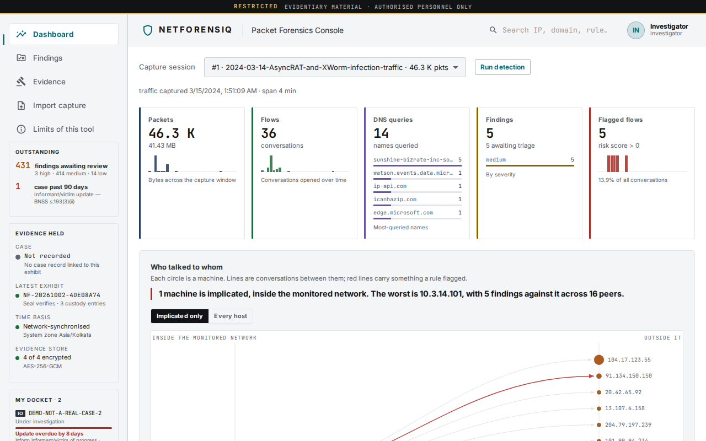<br><sub><b>Dashboard.</b> A real XWorm/AsyncRAT infection capture: one implicated machine, its peers, and the conversations a rule flagged.</sub></td>
<td width="50%">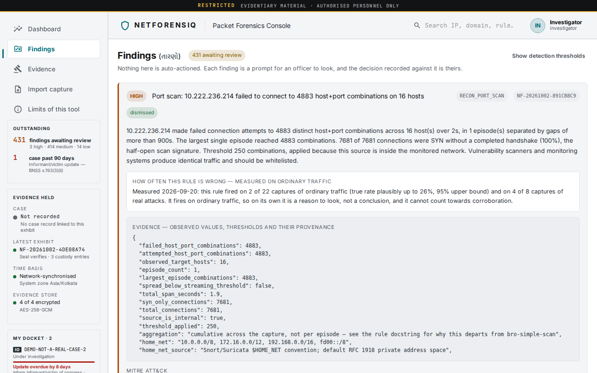<br><sub><b>A finding, with its error rate.</b> "How often this rule is wrong": 2 of 22 ordinary captures, 4 of 8 attack captures, and why that makes it a lead and not a conclusion.</sub></td>
</tr>
<tr>
<td width="50%">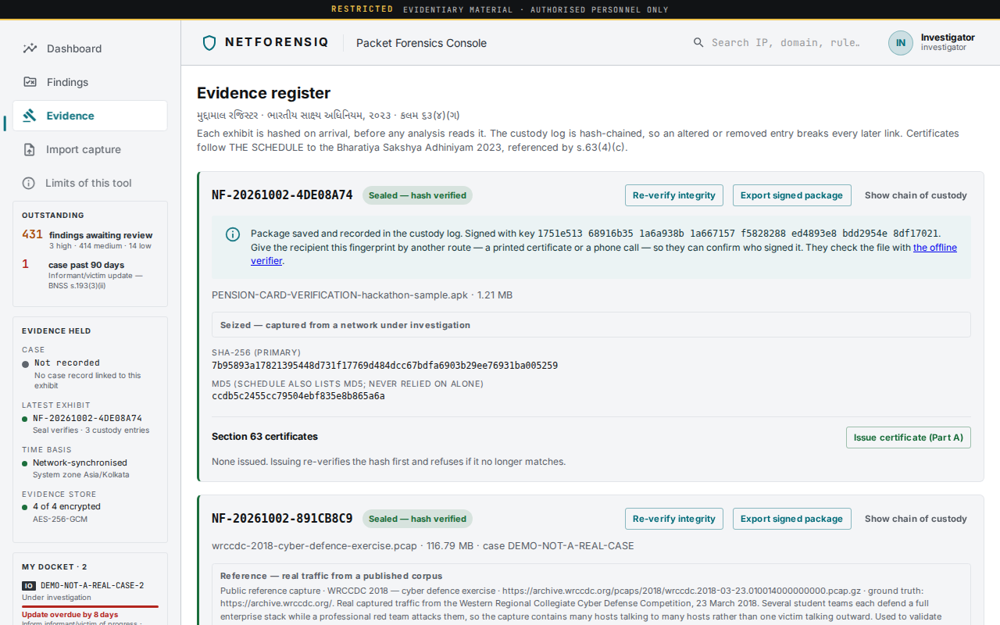<br><sub><b>Evidence register.</b> "Export signed package" appends a custody entry, then shows the key fingerprint to give the recipient by another route.</sub></td>
<td width="50%">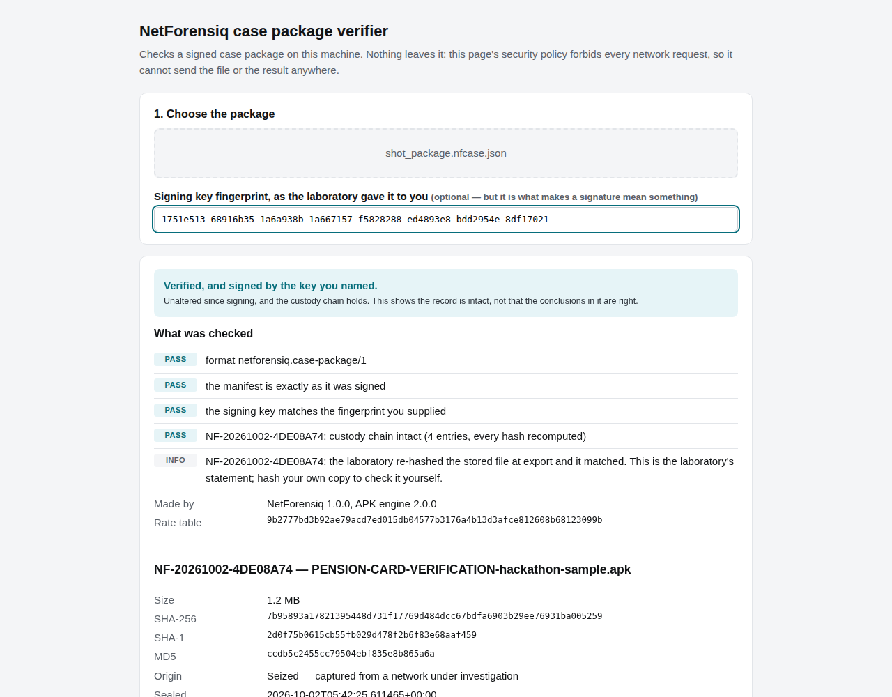<br><sub><b>Offline verifier.</b> One HTML file, no network. A package checked against the fingerprint the laboratory gave: verified.</sub></td>
</tr>
<tr>
<td width="50%">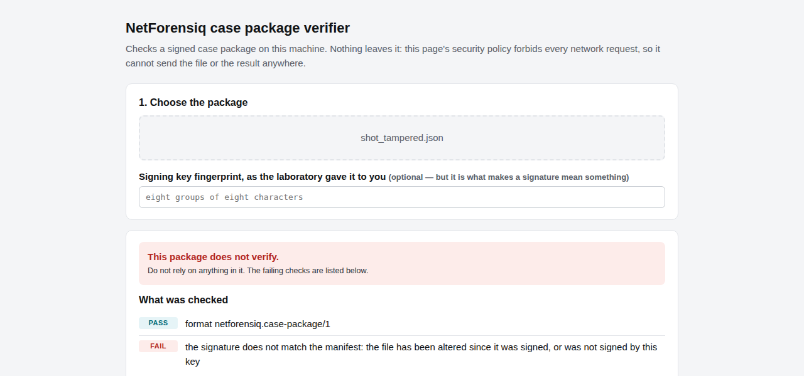<br><sub><b>Same page, one character changed.</b> The signature no longer matches, so nothing from the file is shown as if it could be trusted.</sub></td>
<td width="50%">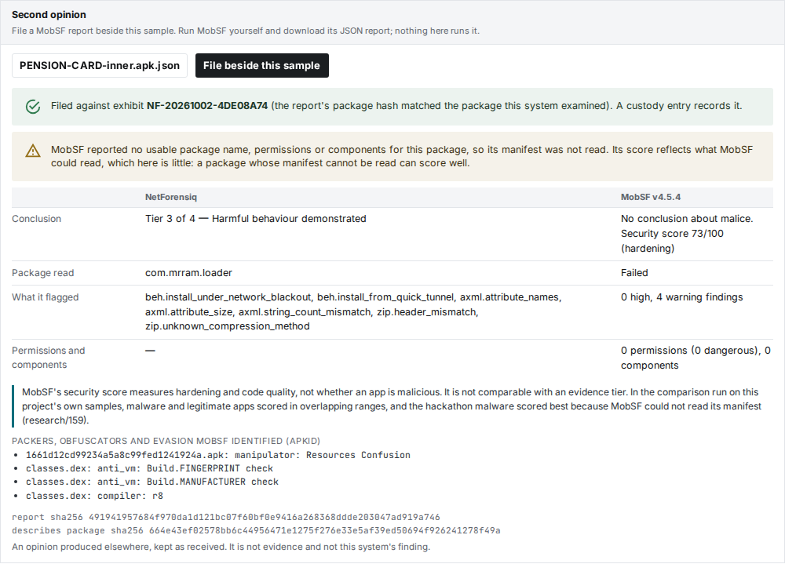<br><sub><b>Second opinion.</b> The hackathon sample: tier 3 here; MobSF read package "Failed", no permissions, score 73/100, and the panel says why that number is not a verdict.</sub></td>
</tr>
<tr>
<td width="50%">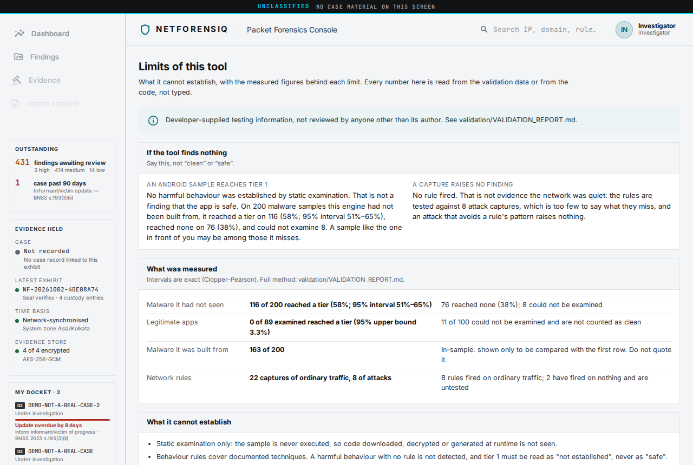<br><sub><b>Limits of this tool.</b> What to say when nothing is found, the measured figures behind it, and what the tool cannot establish.</sub></td>
<td width="50%">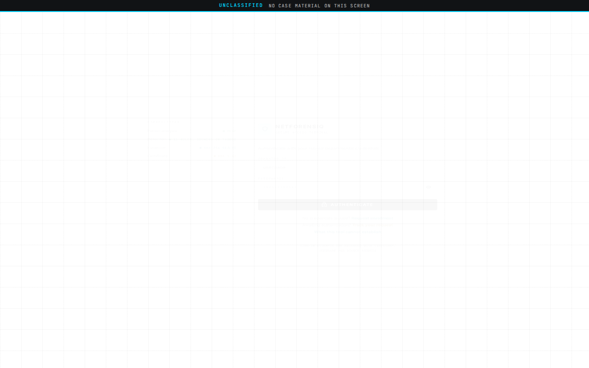<br><sub><b>Sign-in.</b> Marked UNCLASSIFIED because it holds no case material, and linking to the Limits page before anyone has an account.</sub></td>
</tr>
</table>

---

## The Problem

Arkime, Zeek and Suricata will show you packets. **None of them will hand an investigating officer a document a magistrate can accept.**

Indian digital evidence lives or dies on the **Bharatiya Sakshya Adhiniyam (BSA) 2023, Section 63**. Physical seizure already has its rails — eSakshya videographs the scene, CCTNS logs the hard drive into the malkhana. Network evidence falls straight through the gap between them.

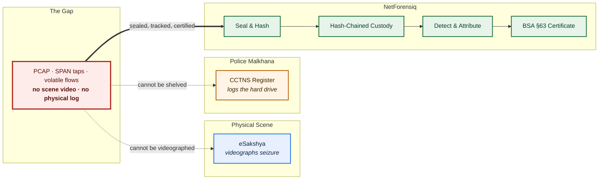

> **NetForensiq is not another packet analyser.** It is the *legal admissibility and chain-of-custody layer* for network evidence.

---

## Where this fits — phones already scan apps, so why a tool at all?

**It does not compete with the scanner on the phone, and it would lose if it tried.** Google Play Protect catches 99.8% of new Android malware in AV-TEST's May 2025 test; this engine catches 58% of the unseen malware it was measured on ([details below](#compared-with-what-is-already-on-the-phone--google-play-protect)). Those scanners have one job: decide, on the handset, whether an install goes ahead.

This project starts where that job has already failed. A victim has been defrauded, walks into a police station, and an officer has to establish *what happened* in a form that survives cross-examination:

| | Scanner on the phone | NetForensiq |
|---|---|---|
| When it acts | Before or at install | After the fact, on an exhibit an officer holds |
| What it gives | A warning to the user | Reasons — the call path, the permission, the forged header, each signal's measured error rate |
| Evidence handling | None | Sealed on intake, hash-chained custody, BSA §63 certificate |
| Network traffic | Not examined | The core of the tool: PCAP import, flow assembly, 11 rules with published error rates |
| Where it runs | On the phone, with Google's servers | Offline, in the lab; makes no outbound connection by default |

### Why phones still get infected, when the scanner catches 99.8%

The cases that reach police are the ones prevention missed. From published reporting:

- **The 99.8% is measured on malware that is already in circulation.** AV-TEST tests against recent samples — its reference set is "widespread Android malware from the last 4 weeks" ([AV-TEST](https://www.av-test.org/en/antivirus/mobile-devices/android/may-2025/google-play-protect-46.1-253308/)). A freshly repackaged "bank KYC" or "e-challan" app has not been seen by anyone yet, and campaigns keep producing new ones.
- **The victim is persuaded to install it.** Microsoft Threat Intelligence documented a campaign against Indian users that sends APKs over WhatsApp and Telegram posing as banks, government services and utilities, stealing card PINs, PAN details, banking credentials and SMS one-time passwords. It works only because the victim enables installation from unknown sources ([The Hacker News, Nov 2023](https://thehackernews.com/2023/11/malicious-apps-disguised-as-banks-and.html)). A scanner warns; a user who has been told their account will be blocked taps through.
- **The first app is a dropper.** It looks harmless when scanned and installs the real payload afterwards. ThreatFabric documented *SecuriDropper*, a dropper-as-a-service built to get around Android 13's restrictions on sideloaded apps by imitating an app store's install process, used to deliver SpyNote spyware and banking trojans ([ThreatFabric](https://www.threatfabric.com/blogs/droppers-bypassing-android-13-restrictions)). The sample handed out at KANAD S.H.I.E.L.D. 2026, "PENSION CARD VERIFICATION", is this shape: a downloader that installs packages while routing all traffic through its own VPN.
- **The India-specific block is narrow by design.** Play Protect's enhanced fraud protection blocks only installs from browsers, messaging apps and file managers, and only when the app declares SMS, notification or accessibility access ([Google](https://blog.google/intl/en-in/products/launching-enhanced-fraud-protection-pilot-in-india/)). Measured here on 198 readable unseen malware samples, that rule would block 40% of them.

None of this is measured by this project except the last line; it is why a tool for *after* an infection is still needed, not a claim about how often each route occurs.

---

## Quick Start

```bash
git clone https://github.com/Anbu-00001/NetForensiq.git
cd NetForensiq

docker build -t netforensiq:latest .

docker run -d --name netforensiq --restart unless-stopped \
  -p 127.0.0.1:8000:8000 \
  -v netforensiq_db:/app/data \
  -v netforensiq_evidence:/app/evidence_store \
  -e SECRET_KEY="change-me-before-real-use" \
  -e ALLOWED_HOSTS=127.0.0.1,localhost \
  -e SQLITE_NAME=/app/data/netforensiq.sqlite3 \
  netforensiq:latest
```

Open **http://127.0.0.1:8000** · seed the demo data with:

```bash
docker exec netforensiq python manage.py seed_demo
```

| Account | Role | Can do |
|---|---|---|
| `investigator` | Investigator | Import captures, triage findings, seal exhibits, sign Part A |
| `expert` | FSL / Examiner | **Countersign Part B**, examine APK samples |
| `commander` | Administrator | Approve accounts, read the sign-in log, examine samples |
| `viewer` | Viewer | Read-only |

<sub>Demo password for all four: `Netforensiq@2026`. `pending-applicant` fails by design — it demonstrates the approval gate.</sub>

> Bound to **loopback**, not `0.0.0.0`. A forensic tool that appears on the station LAN the moment it starts is not a decision anyone made.

---

## The Evidence Lifecycle

Everything in NetForensiq flows through one pipeline. **The hash is taken before anything reads the file** — so the artefact the digest describes is the artefact the findings came from.

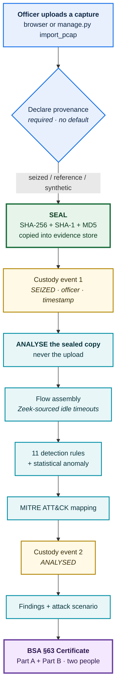

### Why provenance has no default

A default would mean the system deciding, on an officer's behalf, **what a file is** — and the only safe default makes the feature useless. Three declarations, each printed on the certificate:

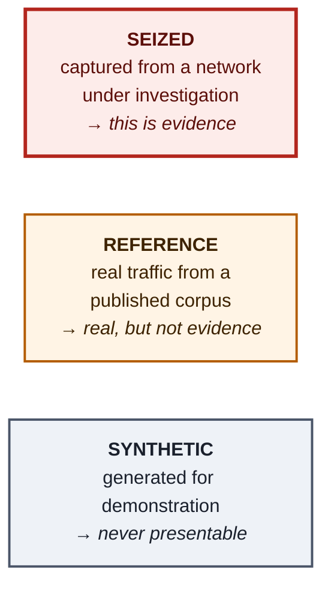

---

## Chain of Custody — Hash-Chained, Not Just Logged

An audit table anyone can `UPDATE` is not a chain of custody. Every custody event carries the hash of the one before it, so **removing or editing any link breaks every link after it**.

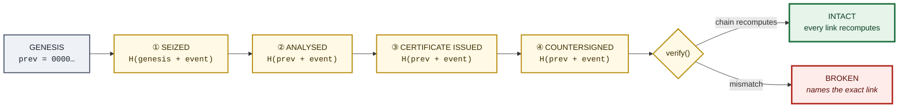

Tampering is reported as *"the chain breaks at event 3"* — not a silent boolean.

**One text, one reading.** An entry's hash covers its fields joined with `|`, unescaped. That is sound only if the joined text splits one way, so `detail` is the only field allowed to contain `|`: the others are integers, a fixed action, an IP address, a timestamp and a hex digest, and the badge number has a database constraint. Until 30 Oct 2026 it did not, and an outside review pointed out that a badge ending in `|` hashed the same as a detail starting with one: text could move between fields with every hash unchanged. Both verifiers now reject an entry where any other field holds `|`, and a test builds exactly that re-split forgery to show it is caught ([research/167](research/167_EXTERNAL_REVIEW.md)).

---

## Hand a Case to the Other Side — Signed Packages and the Offline Verifier

A Section 63 certificate asserts that a file has a particular hash. The people who most need to test that — defence counsel, a magistrate, a second laboratory — have no way to do it except by asking the investigating agency's own system, which is taking the investigator's word for the investigator's own exhibit.

So the laboratory exports **one signed file**, and the recipient checks it in a browser on their own machine: no account, no install, no network.

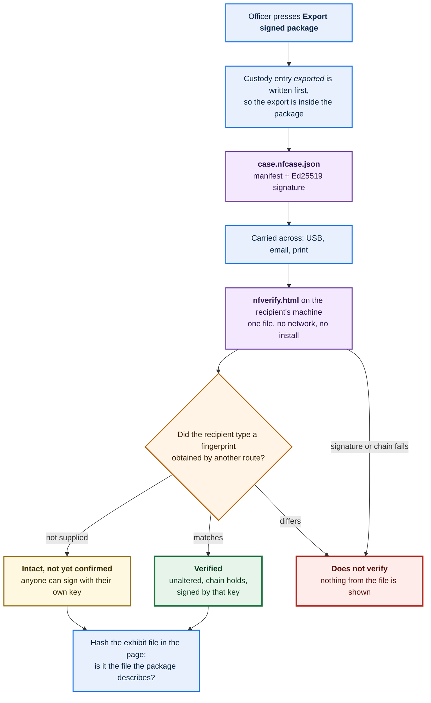

<table>
<tr>
<td width="50%"></td>
<td width="50%"></td>
</tr>
</table>

| A pass shows | A pass does **not** show |
|---|---|
| The package is unaltered since it was signed (Ed25519 over the exact manifest text) | **That the key is the laboratory's.** Anyone can sign a package with their own key and it will verify. The recipient must compare the fingerprint with one obtained another way |
| Every custody entry still hashes to what is recorded; none was removed from the middle, reordered or cut off the end | That the log was never rebuilt *before* signing. A hash chain proves consistency, not that nobody recomputed it |
| The file in the recipient's hand is, or is not, the exhibit (or the certificate PDF) the package describes | That the evidence is genuine or the findings are correct |

> [!NOTE]
> A forged package signed with someone else's key **verifies** — the tests build one and show it. Only the fingerprint comparison exposes it. The page says so, in the box above the result.

**Why the page can be trusted not to phone home.** It carries `default-src 'none'` and `connect-src 'none'`, with scripts and styles allowed only by hash. A browser test points `fetch`, XHR, an image, a beacon, a WebSocket, a script element and an iframe at a local server: with the policy it receives nothing; with the policy deleted it receives all seven, and the test fails. The page rebuilds byte for byte from pinned sources, and its SHA-256 is published beside it. Because the page never receives a file, a copy on a static host (a Hugging Face Static Space, GitHub Pages) holds no evidence and stores nothing; it is the one part of this project that can sit on the internet without contradicting the rest. Full detail in [`verifier/README.md`](verifier/README.md) and [research/162](research/162_CASE_PACKAGE_AND_VERIFIER.md).

---

## Detection Engine

Eleven rules, every one **deterministic and citable**. No black-box score decides whether someone is prosecuted.

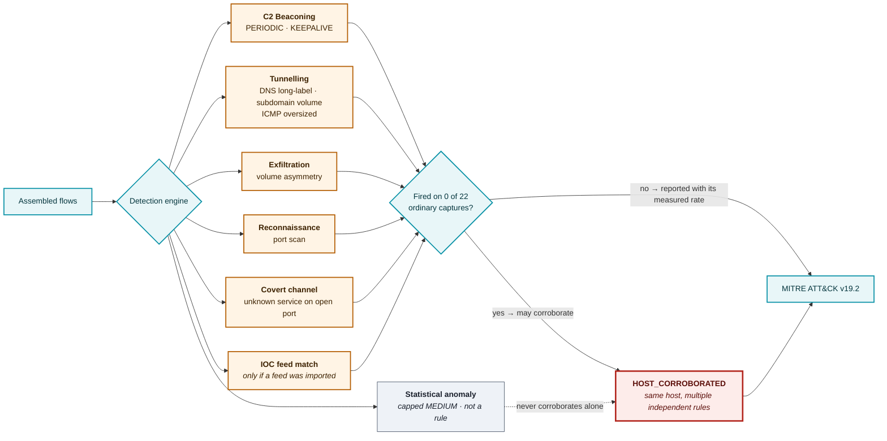

| Rule ID | Detects | Threshold source |
|---|---|---|
| `C2_BEACON_PERIODIC` | Regular callback intervals | Published, with interval statistics shown |
| `C2_BEACON_KEEPALIVE` | Regular data-bearing sends inside one long connection (bare TCP keep-alives excluded, RFC 1122) | Ours, scored with RITA's formula — shown at LOW until seen on an attack |
| `DNS_TUNNEL_LONG_LABEL` | Oversized DNS labels | RFC 1035 label limits |
| `DNS_TUNNEL_SUBDOMAIN_VOLUME` | Many never-used names under one registered domain (Public Suffix List) | Elastic's method; count threshold ours |
| `ICMP_TUNNEL_OVERSIZED` | ICMP payloads carrying data | Published |
| `EXFIL_VOLUME_ASYMMETRY` | Outbound ≫ inbound | Published + entropy sample count |
| `RECON_PORT_SCAN` | **Failed** connections across hosts and ports | Zeek / Snort 3 |
| `COVERT_CHANNEL_UNKNOWN_PORT` | Unrecognised service on a permitted port | Published |
| `IOC_FEED_MATCH` | Endpoint on an imported feed | Feed's own retrieval date |
| `HOST_CORROBORATED` | One host implicated by **several independent rules, each measured silent on ordinary traffic** | Derived |
| `ANOMALY_STATISTICAL` | Unsupervised outlier | Cites nothing — capped MEDIUM by design |

> Every threshold is served live at `GET /api/detections/thresholds/` — **36 thresholds**, each tagged as sourced or heuristic. A number an officer cannot decompose is a number they cannot testify to.

---

## APK Examination — evidence tiers, not a score

Submitted samples are sealed like any other exhibit, then examined **statically** — never executed, never sent to a cloud scanner. The examination runs as a **separate, memory-limited process**: androguard and apkInspector (Apache-2.0) never share an address space with scapy (GPL-2.0-only), and a sample built to crash a parser takes down a worker, not the server.

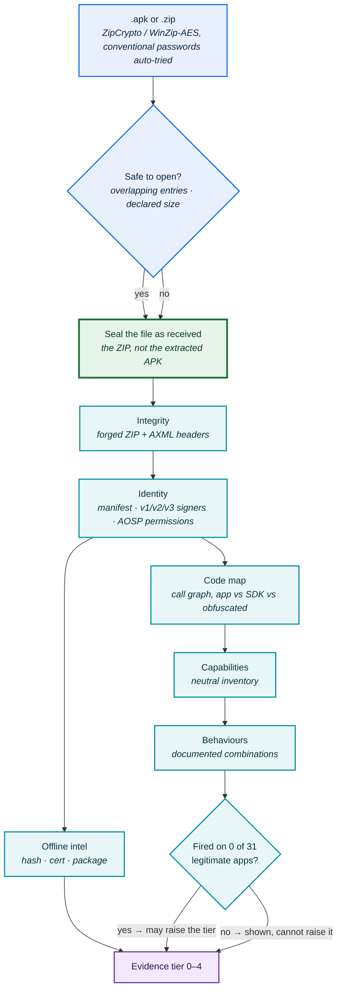

| Tier | Means | Needs |
|---|---|---|
| **4** Known harmful software | The file or its signing key is a listed harmful product | Hash or certificate match in a bundled indicator set |
| **3** Harmful behaviour demonstrated | A documented malware technique is in the app's own code | A validated behaviour rule, with the call path shown |
| **2** Built to evade inspection | Constructed to defeat analysis tools or hide from the user | A validated integrity indicator |
| **3 / 2** Not the application it claims to be | Declares a known package name but is not signed by the key on record | A reference-set entry; tier 3 when that entry is the publisher's own key, 2 when it is one distributor's build |
| **1** No harmful behaviour established | Examination completed; nothing above was found | — **never means "safe"** |
| **0** Could not be examined | Parsing, memory or time ran out | — never presented as a clean result |

### What the network rules do to ordinary traffic (19 Sep 2026)

The APK engine's verdicts rest on a measured benign base rate. **The network rules had no equivalent until now**, and measuring them was not flattering. Run over 16 captures of ordinary user traffic from the CTU Malware Capture Facility's *Normal* set — Windows machines browsing the web, no staged attacks, 134,739 flows — **every rule that fires at all fires on legitimate traffic** ([research/157](research/157_NETWORK_RULE_BASE_RATES.md)).

Four of those firings were defects, each fixed against what Zeek, Snort and the Threshold Random Walk paper (Jung et al., IEEE S&P 2004) actually do:

| Rule | Benign captures before | after | Malicious captures |
|---|---:|---:|---:|
| `RECON_PORT_SCAN` — now counts **failed** connections, as Zeek does, not fan-out | 8 / 16 | **1 / 16** | 4 / 7 → **4 / 7** |
| `C2_BEACON_PERIODIC` — a median interval of ~0s is a burst, not a schedule | 8 / 16 | **4 / 16** | 1 / 7 → 0 / 7 |
| `HOST_CORROBORATED` | 7 / 16 | **5 / 16** | 0 / 7 |
| `C2_BEACON_KEEPALIVE` — one finding per (host, peer, port), not per connection | 1,150 findings | **597** | 0 / 7 |
| **Total findings on benign traffic** | **1,803** | **1,221** | 1,138 → 1,136 |

The port-scan fix removed seven of eight benign firings **and cost nothing on the malicious side**. The single malicious finding that disappeared was the zero-interval artefact itself — a false statement withdrawn from both corpora, not a detection lost.

**The four defects that measurement left open were then fixed and measured again** ([research/158](research/158_NETWORK_RULES_MEASURED_AGAIN.md)):

| Defect | Fix, and its source | Same 16 captures | 6 captures nothing was fitted to |
|---|---|---:|---:|
| `C2_BEACON_KEEPALIVE` read idle browser sockets as beacons | Only data-bearing packets count as sends — a TCP keep-alive "either contains no data or consists of one octet" (RFC 1122), and Chromium probes idle sockets every 45 s | 597 → **37** findings | 3 / 6, all LOW |
| DNS tunnelling counted CDN and cloud hostnames | Group by registered domain (Mozilla Public Suffix List, shipped offline); count only names the host never connected to — Elastic's "loose ends" test | 4 → **1** captures | 1 / 6 |
| `HOST_CORROBORATED` (CRITICAL) fired on ordinary traffic | Only rules measured silent on ordinary traffic may corroborate — the APK engine's bar | 5 → **0** | **0 / 6** |
| No finding said how often its rule is wrong | Every finding now carries its rule's measured rate, on screen and in the report | — | — |

**Each finding now states its rule's error rate in plain words**, from `backend/capture/data/rule_base_rates.json` — measured on 22 captures of ordinary traffic and 8 of real attacks, never hand-edited:

| Rule | Ordinary traffic | Attacks | Effect |
|---|---:|---:|---|
| `RECON_PORT_SCAN` | 2 / 22 | 4 / 8 | reason to look, cannot corroborate |
| `COVERT_CHANNEL_UNKNOWN_PORT` | 6 / 22 | 3 / 8 | reason to look, cannot corroborate |
| `DNS_TUNNEL_LONG_LABEL` | 1 / 22 | 2 / 8 | reason to look, cannot corroborate |
| `DNS_TUNNEL_SUBDOMAIN_VOLUME` | 2 / 22 | 1 / 8 — a real iodine tunnel, caught | reason to look, cannot corroborate |
| `EXFIL_VOLUME_ASYMMETRY` | 8 / 22 | 1 / 8 | reason to look, cannot corroborate |
| `ICMP_TUNNEL_OVERSIZED` | 2 / 22 | 1 / 8 | reason to look, cannot corroborate |
| `C2_BEACON_KEEPALIVE` | 10 / 22 | **0 / 8** | **shown at LOW** — never seen to fire on an attack |
| `C2_BEACON_PERIODIC` | 4 / 22 | **0 / 8** | **shown at LOW** — the attack corpus has no connection-per-callback beacon, so it is untested there |
| `IOC_FEED_MATCH` | 0 / 22 | 0 / 8 | untested; the only rule allowed to corroborate |

**Still wrong, stated rather than hidden:** "fired on an attack capture" is not "caught the attack" — the long-label rule's wrccdc firing is a CDN name; eight attack captures is thin; browsers' DNS prefetching still looks like a tunnel's loose ends; and 22 captures bound even a silent rule's true benign rate at 12.7%. With every rule firing on some ordinary traffic, `HOST_CORROBORATED` will essentially not fire — correct for a finding that says CRITICAL, until the rules under it are specific.

### The rule that keeps it honest

**A signal may only raise a tier if it fired on _zero_ apps in the legitimate reference corpus.** Everything else is reported with its count and cannot move the verdict. The corpus is 201 examined F-Droid apps: 23 chosen because they legitimately do what malware does — install packages (F-Droid, Droid-ify, Aurora Store), create VPNs (NetGuard, RethinkDNS, AdAway, OpenVPN), handle SMS (Fossify Messages), automate through accessibility (Key Mapper), run shell commands (Termux) — plus 200 sampled at random. Benign firings seen on the earlier 31-app corpus, which included a Play Store build of Flipkart and seven locally built apps no longer on disk, are carried forward rather than lost: re-measuring cannot validate a signal by losing the evidence against it.

Measured on that corpus (`backend/apk_engine/data/baselines.json`, regenerate with `python -m apk_engine evaluate`):

| Signal | Legitimate apps | Malicious sample | Verdict effect |
|---|---|---|---|
| Installs packages | **13 / 31** | yes | capability only |
| Creates a VPN interface | **4 / 31** | yes | capability only |
| **Installs a package while routing all traffic into its own VPN** | **0 / 31** | yes | **raises to tier 3** |
| Forged ZIP / AXML headers | **0 / 31** | yes | raises to tier 2 |
| Disables its own launcher icon | **1 / 31** | no | reported, cannot raise |

The judge's sample from KANAD S.H.I.E.L.D. 2026 (`com.mrram.loader`, delivered as "PENSION CARD VERIFICATION") reaches **tier 3 — Hostile downloader**, on its own `MainActivity` feeding a `PackageInstaller` session while `InstallVpnService` routes `0.0.0.0/0` and `::/0` into a local VPN, plus a Cloudflare quick-tunnel stage-2 URL and five forged-header indicators. Flipkart reaches **tier 1**. Under the previous additive score it was the other way round: Flipkart scored 100/100 "Remote access trojan", on a root *check* inside NPCI's UPI library.

### Measured against real corpora (19 Sep 2026)

Both halves were measured, on corpora kept apart before anything was examined, because a detection rate on the samples a rule was written from proves nothing. Full method, every intermediate result and the two findings that went against us are in [research/154](research/154_APK_DETECTION_REBASELINE.md).

| | Corpus | Result |
|---|---|---|
| **Detection — blind set, scored once (19 Sep 2026)** | 100 more MalwareBazaar APKs, downloaded by excluding both earlier corpora and left unexamined until the engine was frozen | **52 / 100 = 52.0%** (95% CI 41.8–62.1) |
| Detection — held-out set | 100 MalwareBazaar APKs, selected by excluding the design corpus *before* any was examined | 64 / 100 = 64.0% (95% CI 53.8–73.4) |
| **Detection — both unseen sets together** | **200** | **116 / 200 = 58.0%** (95% CI 50.8–64.9) |
| **False positives — unseen legitimate apps** | 100 F-Droid APKs sampled with a new seed, examined only after the last engine change; re-checked on the shipped engine | **0 / 89 examined** (one-sided 95% bound 3.3%); 11 could not be examined and are not counted as clean |
| In-sample, for comparison only | the 200 MalwareBazaar APKs the rules were built from | 163 / 200 = 81.5% |

Held-out set by tier: 4 — known harmful software: **2** · 3 — harmful behaviour demonstrated: **17** · 2 — built to evade inspection: **45** · 1 — nothing established: **31** · 0 — could not be examined: **5**.
Blind set by tier: 4: **4** · 3: **23** · 2: **25** · 1: **45** · 0: **3**.

**The blind set scored lower than the held-out set, and that result stands.** It was scored once, on the engine exactly as it ships, and the pre-registered prediction that it would reach 64 or more was wrong. The difference is almost all in tier 2: 45 held-out samples reached it (integrity indicators — forged archive headers) and 25 blind ones. The likeliest reason, which was not tested, is that the engine's strongest signal is a packaging trick and the blind set is the 600 most recent uploads, which may use it less. **58% on 200 unseen samples is the number to quote.**

**How it got here, and what did not help.** The engine was at **34%** with five behaviour rules and baselines measured on 31 apps. Adding five more rules changed **no tier at all** — a rule that has never been measured against legitimate software cannot raise one, by design. Re-measuring the baselines on the larger corpus is what moved it: ten ZIP/AXML tampering indicators fire on 0 of 201 legitimate apps and on 114 of 200 malicious ones, and once validated they took unseen-malware detection to **63%**. Two further rules, NFC card relay and packed payload, projected to ~82% on the design set and added **one point** on unseen malware: they were fitted to one campaign that the held-out set does not contain. The held-out test also caught three defects before they shipped — a Qt app flagged because framework code was read as the developer's, and two native-code apps whose compressed data looked "packed" — each fixed and recorded.

**The gap between 81.5% and 64% is the finding.** Rules written from a corpus score well on that corpus. The number to quote is the one on malware the engine had never seen.

### What these numbers do and do not support

The false-positive bound depends on corpus size — the exact one-sided 95% upper bound for zero firings is **9.2% at n=31**, **3.0% at n=100**, **1.5% at n=201**. The fresh-app figure (89 of 100 examined; the bound there is 3.3%, not 3.0%, because 11 could not be examined) is the only one measured on apps the engine had not been adjusted against; the 201-app baseline is zero by construction.

But F-Droid is a cleaner population than the field: its builds carry **89% fewer tracking libraries** than their Google Play equivalents (University of Oxford, 2025), and developers routinely ship a stripped FOSS variant there. The app that broke the old scorer was a *Play* build of Flipkart, whose merged manifest declares components under `com.facebook`, `in.juspay` and `org.npci.upi` — exactly the class F-Droid under-represents.

So the supported claims are **"caught 64 of 100 unseen MalwareBazaar APKs"** and **"flagged none of 100 unseen F-Droid apps"**. They are *not* "detects 64% of Android malware" or "fires on fewer than 3% of Android apps" — MalwareBazaar is what researchers upload, and F-Droid is cleaner than the Play Store — and those stronger sentences are not made anywhere in this repository.

### Compared with what is already on the phone — Google Play Protect

**On detection rate, NetForensiq is not better than Google Play Protect, and nothing in this repository claims it is.** The measured numbers do not support it:

| | Samples | Detected |
|---|---|---|
| **Google Play Protect** — AV-TEST, May 2025 ([report](https://www.av-test.org/en/antivirus/mobile-devices/android/may-2025/google-play-protect-46.1-253308/)) | 2,973 new Android malware samples | **99.8%**, with 0 false warnings |
| Google Play Protect — AV-TEST endurance test, Jul–Dec 2025 ([report](https://www.av-test.org/en/news/endurance-test-security-apps-for-4-billion-android-devices/)) | ~9,000 new + ~9,000 known | 99.6% / 99.7% |
| **NetForensiq** — this repository | 200 unseen MalwareBazaar APKs | **58.0%** (95% CI 50.8–64.9) |

These are not the same samples, so the rows are not a head-to-head, and the size of the gap is not a measured difference. It is large enough, though, that reading it as NetForensiq being ahead would be wrong. Play Protect's full scanner could not be run here: it lives on an Android device and in Google's cloud, where it checks each install "against known harmful or malicious samples" and, for apps it has not seen, uploads extracted signals "for evaluation by Google" ([Google](https://developers.google.com/android/play-protect/client-protections)). MalwareBazaar samples are public, so Play Protect very likely knows most of ours by hash; that is an expectation, not a measurement.

**The one part of the phone's install-time check that *can* be reproduced was measured head to head.** In India, Play Protect's *enhanced fraud protection* (Nov 2024) blocks any app installed from a browser, messaging app or file manager that declares **RECEIVE_SMS, READ_SMS, notification-listener or accessibility access** ([Google](https://blog.google/intl/en-in/products/launching-enhanced-fraud-protection-pilot-in-india/)). That rule is published exactly, so `scripts/efp_permission_check.py` applies it, in the same sandbox, to the same samples the engine was scored on:

| Same samples | NetForensiq flags | Google's fraud rule would block | Both | Either |
|---|---:|---:|---:|---:|
| Held-out malware (100) | **64** | 46 | 30 | 80 |
| Blind malware (100) | **52** | 33 of 98 readable | 18 | 67 |
| **Unseen malware, total (200)** | **116 (58%)** | **79 of 198 (40%)** | 48 | 147 (74%) |
| Legitimate F-Droid apps (100), if downloaded through a browser | **0** of 89 examined | **3** — two launchers and a notification vault, all using accessibility | — | — |

So, measured on the same 200 samples: **the engine catches more malware than India's install-time fraud rule (58% vs 40%) and blocked no legitimate app where the rule would block three.** The rule and the engine also catch different things — together they reach 74%, and 31 samples the rule blocks are ones the engine misses. That is the defensible comparison, and it is the whole of it: this is one published rule, not Play Protect.

**The phone's "default" scanner is Play Protect.** On Android phones that ship with Google Play services, the check that runs when an app is installed from a browser is Play Protect itself. Some manufacturers add a second scanner: Samsung's *Device protection* is powered by McAfee ([SamMobile](https://www.sammobile.com/news/mcafee-will-offer-virus-protection-to-samsung-devices-for-at-least-nine-more-years/)), and Xiaomi's *Security* app lets the user choose Avast or AVL ([Check Point Research](https://research.checkpoint.com/2019/vulnerability-in-xiaomi-pre-installed-security-app/)). McAfee and Avast both scored the maximum 6/6 for protection in [AV-TEST's July 2025 Android test](https://www.av-test.org/en/antivirus/mobile-devices/android/july-2025/) — on their retail apps, not the versions built into these phones, and AV-TEST's summary does not publish their exact rates. Nothing suggests either is weaker than Play Protect, so none of them is claimed to be beaten here either.

What NetForensiq is for instead is set out in [Where this fits](#where-this-fits--phones-already-scan-apps-so-why-a-tool-at-all).

### Compared with MobSF, on the same samples

MobSF is the standard open-source Android static analyser. It was evaluated and deliberately not shipped ([research/150](research/150_APK_MALWARE_CLASSIFICATION.md) §2.1) — it is GPL-3.0, and it does not classify malware. Running it over 14 of the same samples measures what that means in practice ([research/159](research/159_MOBSF_COMPARISON.md)):

| App | MobSF security score | This engine |
|---|---:|---|
| `com.mrram.loader` — the KANAD S.H.I.E.L.D. malware sample | **73 / 100**, the best score in the test, 0 high findings | **tier 3** — installs a package under its own VPN, second stage from a Cloudflare quick tunnel |
| `org.fdroid.fdroid` — legitimate | 62 | tier 1 |
| `de.blinkt.openvpn` — legitimate | 52 | tier 1 |
| `com.termux` — legitimate | 47 | tier 1 |
| 9 blind-set malware samples | 46 – 67 | 4 flagged, 5 missed |

Every score fell between 46 and 67, with the legitimate apps in the middle of the malware. The hackathon sample scored *best* because its manifest is deliberately malformed — MobSF's own APKiD module names the technique, "Resources Confusion" — so its manifest parse returned 0 permissions, 0 activities and 0 services, and a score computed from findings rewarded finding nothing.

**None of that is a defect in MobSF**, which is a better workbench than this engine by most measures: trackers, certificate detail, packer identification, code-pattern rules, a web UI, and dynamic analysis with Frida that this project does not have at all. It is a defect in reading a hardening score as a malware verdict. The one place the two genuinely disagree is tampered archives: MobSF returned HTTP 500 on a sample whose ZIP was corrupted (`UnboundLocalError` in its fallback extraction), where this engine treats the tampering itself as the finding.

### Second opinion — filing MobSF's report beside a sample

A lab that already runs MobSF has a report in hand when a sample arrives. It can be filed against the sealed exhibit and read next to this engine's conclusion.

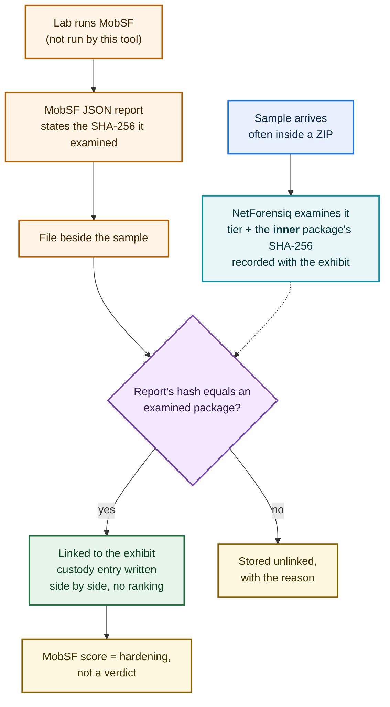


* **Matched by hash and by nothing else.** A sample that arrives inside a ZIP is sealed as the ZIP, while MobSF reports the inner package's hash, so each examination now records *both* — the engine's conclusion used to live only in an HTTP response.
* **No ranking, no agreement score.** MobSF's security score measures hardening, not malice. On the hackathon sample MobSF could not read the manifest (package "Failed", no permissions) and scored it **73/100**, the best score of any app in that comparison.
* **A report is treated as hostile input.** Whitelisted fields, bounded lists, text rendered as text, encrypted at rest, never executed. Filing is a custody event and the chain still verifies.

Six defences were each removed in turn to confirm a test fails; one of my own assertions was too weak and was found that way. [research/166](research/166_SECOND_OPINION.md).

### Two design decisions worth reading

**① Capability is not intent.** Google Play explicitly permits SMS permissions for UPI apps, and a banking SDK is *expected* to check for root. So permissions and API calls are an inventory, and only combinations that published threat research documents — each citing that report, listing the legitimate apps that look similar, and mapping to MITRE ATT&CK — can establish harm.

**② Whose code is it?** A finding names the calling class, attributed to the app, to a named SDK (Exodus signatures) or to obfuscated code. A capability that exists only inside a bundled library is counted separately and never feeds a behaviour rule. Manifest components go through the same split, because the manifest merger copies an SDK's services and receivers into the app's own manifest — an accessibility service declared by a bundled library is not the app declaring one.

### Does it have the identity it claims?

The fraud that reaches Indian complainants is mostly impersonation — an APK called "PENSION CARD VERIFICATION", a fake bank, a fake pay-commission calculator. For those the first question is not what the package *does* but what it *claims to be*, and the answer is an identity fact rather than a statistical one: Android treats the signing key as identity, so a package declaring a known name while signed by a different key is not that application. No corpus is needed to say so, and the defence can check it with `keytool`.

The reference set is built where it is deployed — a laboratory points this at the genuine government and banking apps it has acquired, and every later examination is checked against them:

```bash
python -m apk_engine reference --from /path/to/genuine/apks     --authority publisher --note "Downloaded from Google Play, 18 Sep 2026"
```

`--authority publisher` means *this is the authorised key*, so a mismatch is tier 3. `--authority distributor` means *this key was seen on one channel's build*, so a mismatch is tier 2 and the report says the difference is also consistent with legitimate redistribution. The shipped set holds the 23 F-Droid builds from the evaluation corpus, recorded as `distributor`; it is a working seed, not a national registry.

### Measuring against real malware, without a runnable sample on disk

The engine never executes an APK — there is no Android runtime, so a sample is an inert ZIP and the
exposure is parsing, not detonation. Acquisition keeps it that way: samples are stored as the
password-protected ZIP abuse.ch serves, mode `0400`, named by SHA-256, and are decrypted only onto a
`noexec` tmpfs inside a container with `--network none --read-only --cap-drop ALL`.

```bash
export MALWAREBAZAAR_AUTH_KEY=...          # free key: https://auth.abuse.ch/
python scripts/fetch_malwarebazaar_corpus.py fetch --file-type apk --limit 200     --out ../apk_corpus/malicious_mb      # outside any git work tree; fetch refuses otherwise
./scripts/analyse_untrusted.sh ../apk_corpus/malicious_mb
```

Each sample's SHA-256 is verified after decryption, so a file that is not the one MalwareBazaar
recorded is never examined. Expect a high miss rate — five behaviour rules against a broad sample
set — and do not filter the corpus to samples we already detect; the misses are the specification
for the next rules.

### Reproducible by the other side

Every report carries the means to obtain it again — engine and tool versions, the SHA-256 of each reference file read, the baseline snapshot judged against, and the command. `engine.seconds` is named as the one field that varies between runs, and `apk_engine/tests/test_determinism.py` holds the engine to it. The corpus behind every base rate prints in full:

```bash
python -m apk_engine corpus     # every sample's SHA-256, so the measurement can be contradicted
```

### The correlation nobody else can produce

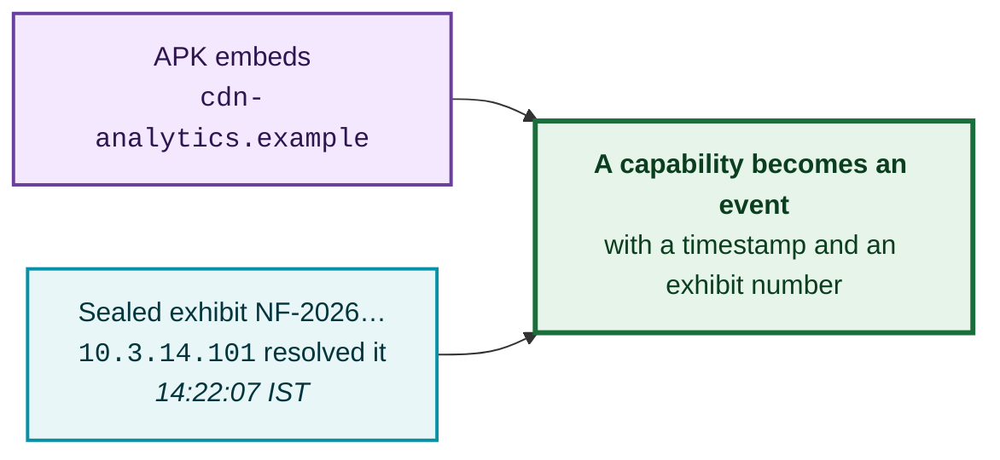

---

## Limits and Validation

The tool says what it cannot establish, and the figures it says it with are generated from the validation data, not typed.


**If it finds nothing, this is what to say** (the Limits page and the sample result carry it, generated from the measured data):

> No harmful behaviour was established by static examination. That is not a finding that the app is safe. On 200 malware samples this engine had not been built from, it reached a tier on 116 (58%; 95% interval 51%–65%), reached none on 76 (38%), and could not examine 8. A sample like the one in front of you may be among those it misses.

```mermaid
flowchart TD
    LG["Run logs +<br/>corpus manifests"]
    EX["extract_validation_data.py<br/><i>counts derived; must equal<br/>the engine's own tally</i>"]
    RJ["validation/results.json"]
    RP["VALIDATION_REPORT.md<br/><i>generated</i>"]
    SM["validation_summary.json<br/><i>inside the image</i>"]
    TS{"Tests: report equals a<br/>regeneration; hashes of the<br/>shipped tables match"}
    UI["Limits page · tier-1 banner ·<br/>report's limits section"]

    LG --> EX --> RJ
    RJ --> RP & SM
    RP & SM --> TS
    SM --> UI

    classDef data fill:#E8F0FE,stroke:#1A73E8,stroke-width:2px,color:#0B2545
    classDef proc fill:#E8F6F8,stroke:#0891A6,stroke-width:2px,color:#04353D
    classDef out fill:#F3E8FD,stroke:#6B3FA0,stroke-width:2px,color:#2E1550
    classDef gate fill:#FFF4E5,stroke:#B35C00,stroke-width:2px,color:#3D2200
    classDef ui fill:#E6F4EA,stroke:#1B6E3C,stroke-width:3px,color:#0B3D1F
    class LG,RJ data
    class EX proc
    class RP,SM out
    class TS gate
    class UI ui
```

* **[`validation/VALIDATION_REPORT.md`](validation/VALIDATION_REPORT.md)** — what the tool is claimed to do, the test data and how little control there was over it, every result, the failures highlighted, the limitations. Arranged after what the UK Forensic Science Regulator's validation guidance (FSR-G-218) asks of a record. It is **developer-supplied information, not a validation of any laboratory's method**, it has not been reviewed by anyone but its author, and it sets no acceptance criteria.
* **It cannot drift.** The report is rendered from `results.json`; a test requires the committed file to equal a regeneration. Another test requires the shipped baseline table and the rate table to match the hashes the report names, so changing the method without re-measuring fails.
* **Deriving it from the logs found four things I had got wrong or not tested:** the false-positive denominator (89 examined, not 100); two unseen sets that had been scored by two different engine images (re-run on one image: 64/100 again, every verdict identical); an explanation for the blind-set drop that had been stated as fact and never tested; and a pre-registered prediction about native-code signals that was false by a wide margin. All four are stated in the report (sections 3 and 5).
* **The investigation report had typed counts that went stale** ("thirty-five thresholds, twenty-three ours", "the ten rules" after the code reached 36, 24 and 11). Its limits section now computes them from the code, and a test scans for the old phrases.
* **The standards are quoted, not claimed.** The page maps the tool onto NIST SP 800-86's four phases (text read in full) and ISO/IEC 27037 (its text is paywalled, so its scope is marked as a secondary summary). Nothing on the page says the tool complies with either.

[research/163](research/163_VALIDATION_REPORT.md).

---

## BSA Section 63 Certificates

Section 63(4) requires **the person in charge of the device and an expert** — two different people. A two-part form that one account can sign twice guarantees nothing.

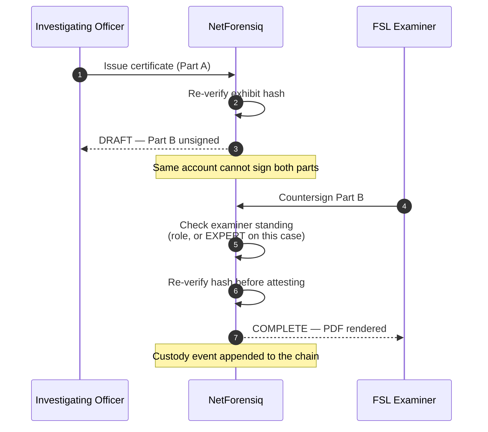

The renderer reproduces **THE SCHEDULE** to the Act — Part A and Part B — and the custody register prints its signature column **empty**, because a signature this system never witnessed is not one it will print.

---

## Performance

Measured on a real **200 MB / 2,274,747-packet** ICS capture (4SICS Geek Lounge):

| Stage | Before | After | Gain |
|---|---:|---:|---:|
| Packet parse + flow assembly | 377.8 s | **34.0 s** | **11.1×** |
| Browser upload → sealed → analysed | 11 m 55 s | **3 m 12 s** | **3.7×** |
| Graph aggregation endpoint (117k flows) | 34.03 s | **1.28 s** | **27×** |

The parse win comes from `capture/fastparse.py`, which reads header fields straight out of the frame with `struct` instead of building a Scapy object per packet.

Those figures were taken without a memory ceiling on the worker. Re-run against the production server command with each process capped at 5 GB, the same capture **ran out of memory** at 4,523 MB and the import failed ([research/155](research/155_PCAP_REAL_CAPTURE_TEST.md) §1) — memory grows with the number of conversations, and this capture holds 946,238.

**Re-measured on 19 Sep 2026, after the import was rebuilt to write flows out in batches ([research/156](research/156_BACKGROUND_IMPORT.md)), under the same 5 GB cap: it completes.** Upload request 1.71 s; a sign-in during the import answered HTTP 200 in 0.52 s; the whole capture read, stored and analysed in **491.9 s**, with the import process peaking at **3,532 MB** (3,957 MB across the server and the import together) — 2,253,190 IP packets (the other 21,557 frames are ARP and other non-IP traffic), 946,238 conversations, 108 findings. Slower than the uncapped figure above, because it now writes as it reads instead of holding everything; it finishes, which it did not.

What *has* been measured since, on real captures through the browser path:

| | Before | After |
|---|---:|---:|
| Upload request, 46 MB / 500,923 packets | 102.0 s | **0.44 s** |
| Same capture, to a fully analysed session | 102.0 s | **89.3 s** |
| Signing in while that import runs | **HTTP 500** after 42.4 s | **HTTP 200** in 1.63 s |

The upload now returns as soon as the exhibit is sealed and hashed; the capture is read by a separate process that reports its progress, so closing the browser no longer has anything to do with whether the import finishes. **330,156 stored flow rows and every finding were compared against the old code, column by column, and are identical** — the import got out of the request without changing a single answer.

**Equivalence is tested, not assumed.** `tests_fastparse.py` runs both readers over real captures and requires *identical* flows, DNS records, byte counts and timestamps. It found two genuine defects the fast path would otherwise have introduced:

- One frame in 2,274,747 declared a TCP `dataofs` of 0 — malformed, and the dissector keeps it. Refusing it lost 1 packet, 1 flow and 62 bytes.
- UDP payloads must **not** be clamped to the length field, because the dissector folds trailing bytes into `Padding` and returns them.

---

## SIEM & Alerting

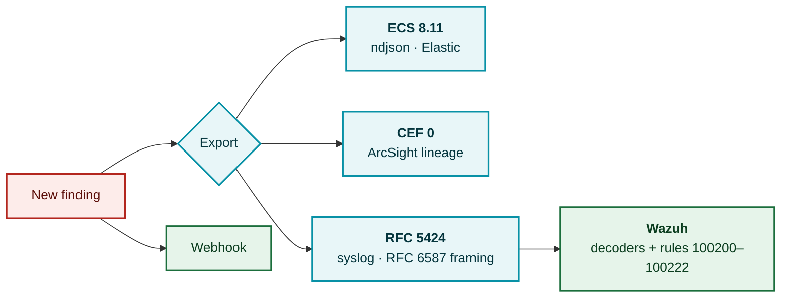

`integrations/wazuh/` ships decoders, a ruleset and `sample-events.log` so the pipeline can be proved with `wazuh-logtest` **before** NetForensiq is running. The test suite parses the shipped XML and runs its regex against live `to_syslog` output — a decoder drifted from its emitter installs cleanly, matches nothing, and reports zero alerts, which is indistinguishable from a quiet network.

> **Honest framing:** syslog is a real integration. The webhook and pull API are *export in an ingestible format*. A SOC engineer knows the difference, so the compliance doc states it.

---

## Architecture

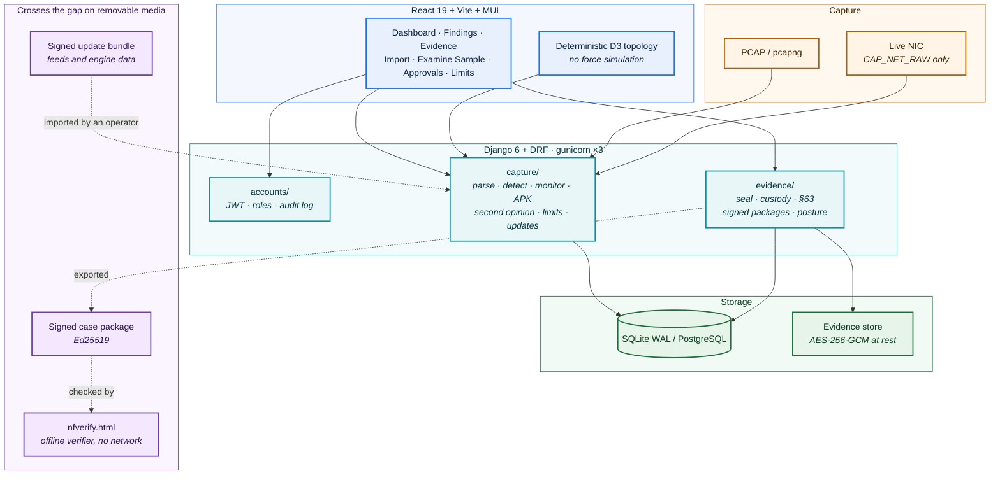

**Why the topology graph is deterministic:** a force simulation draws the same capture differently every time it runs. Reproducibility is an evidence property, so the layout is a two-column ledger — inside the monitored network on the left, outside on the right, arrowheads pointing at whoever answered.

---

## Runs Without a Network

Three claims, each with what it rests on, and a list of what is not claimed.

| Claim | Rests on |
|---|---|
| The platform opens no outbound connection unless an operator configures one | The only calls in the backend that initiate a connection are the optional syslog and webhook alert senders (`capture/alerting.py`), whose targets are empty by default, and `apk_engine/refresh_data.py`, which an operator runs on the connected build machine. No telemetry, no update check, no cloud scanner. Established by searching the code, not by a network trace, and third-party libraries were not audited. |
| The interface loads nothing from outside | Fonts are bundled, and `scripts/build_offline_bundle.sh` fails the build if a built asset references an external host. |
| The application container has no route off the machine | `docker-compose.airgap.yml` puts it on an `internal` Docker network behind a one-line relay that alone publishes `127.0.0.1:8000`. `scripts/verify_airgap.sh` reads Docker's own state and, with `--control`, shows its probe can detect egress. Run end to end on 2 Oct 2026, including a 10 MB capture import through the relay ([research/161](research/161_AIRGAP_AND_CAPABILITIES.md)). |

**Not claimed.** That the host is offline: anything else running on it can still use its network. That every feature works without one: live monitoring needs `--network host`, and SIEM export sends to a server by definition. That citations open: the ATT&CK and source links are web links, so offline the officer sees the citation text and URL but cannot follow it. That the public certificate-verify endpoint is useful on a loopback-only machine: nobody else can reach it.

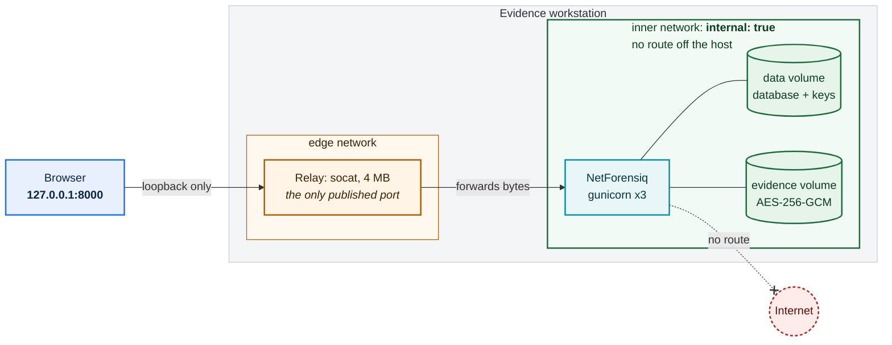

```bash
export NF_IMAGE=netforensiq:1.0.0
export NF_SECRET_KEY="$(openssl rand -base64 48)"
export NF_EVIDENCE_KEY="$(openssl rand -base64 32)"   # keep a copy somewhere else
docker compose -f docker-compose.airgap.yml up -d
scripts/verify_airgap.sh --control
```

`docker run --network none -p ...` starts a container and publishes nothing, with no warning, which is why the relay exists. Building the image needs a network; it is built on a connected machine and carried across with `scripts/save_airgap_images.sh` and `load_airgap_images.sh`, which verify the transfer before loading.

---

## Carrying Things Across the Gap

A laboratory that must not touch the internet still needs the software, new threat data, and a way to hand evidence out. Each crosses on removable media, each is signed, and each can be checked offline by someone who trusts nothing else here.

| What crosses | Format | Checked by | Command |
|---|---|---|---|
| The software | image archive + 4 CycloneDX bills of materials + signed manifest | signature, every artefact's SHA-256, the published fingerprint | `scripts/make_release.py verify` |
| New indicator feeds and engine data | signed update bundle | trusted key (fingerprint typed), rising sequence number, expiry, allow-listed files, payload hashes | `manage.py import_update_bundle --dry-run` |
| Evidence going out | signed case package | the offline verifier | open `nfverify.html` |

### The software: a signed release

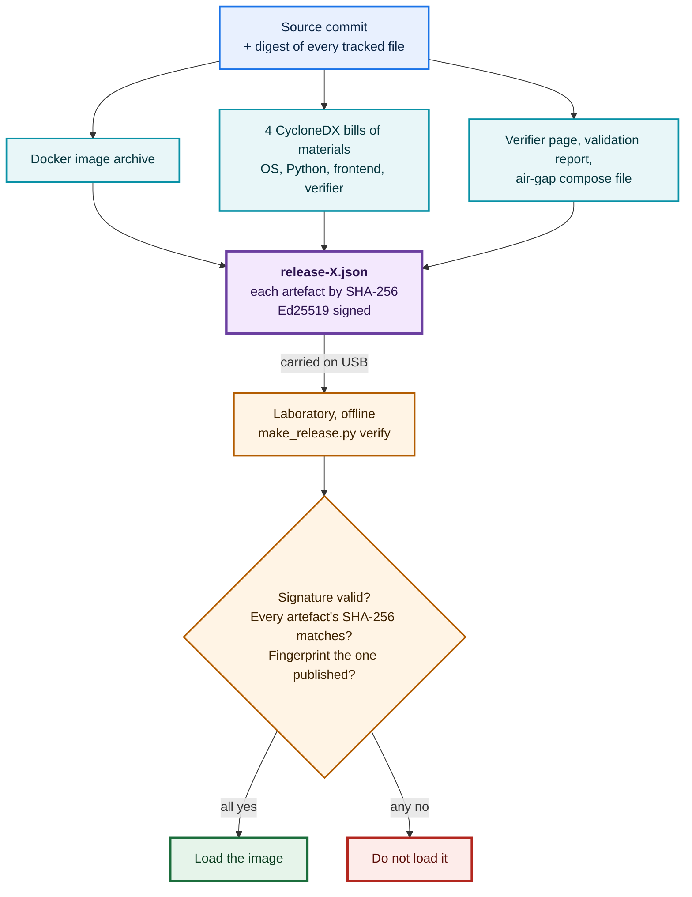

Measured on this repository: the whole release builds in 50 s, the image archive is 193.6 MB, and the four bills of materials hold 40 Python, 92 operating-system, 172 frontend and 4 verifier components, each validated against CycloneDX's own JSON schema. Flipping one byte of any artefact fails verification; so does the wrong fingerprint.

> [!WARNING]
> **Reproducible builds are not claimed.** A Docker image built twice is not bit-identical. The manifest binds one specific archive to a version; what *is* reproducible is the source identity (a digest over every tracked file, recomputable with `scripts/tree_digest.py`). A build from a tree with uncommitted changes is refused unless `--allow-dirty`, and the manifest then says so. **No release has been signed with a real key yet** — publishing the key's fingerprint is the author's decision. [research/165](research/165_SIGNED_RELEASES.md).

### New data: a signed update bundle

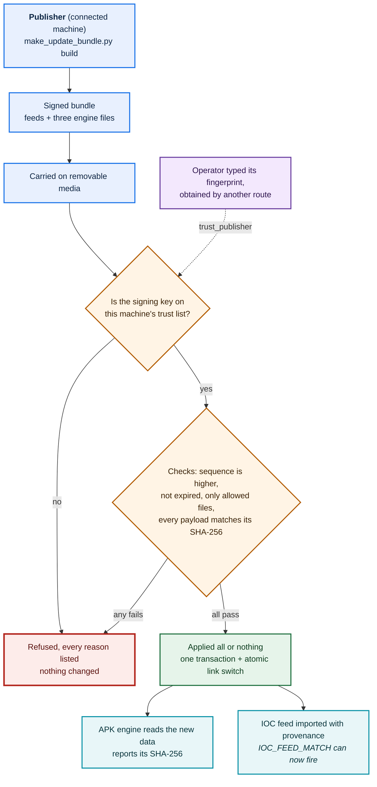

Only indicator feeds and three named engine files can be updated. **The baseline table, the detection rules and the known-signers list cannot**: they define what the method treats as validated, so changing them is re-validation, not an update. A fast-forward by the key's holder and a stolen key are **not** prevented — the answer to both is to stop trusting the key. [research/164](research/164_SIGNED_UPDATES.md).

---

## Tests

```bash
docker exec netforensiq python manage.py test    # 861 backend tests
cd frontend && npx playwright test               # Playwright E2E
cd verifier && npm test                          # offline verifier: known answers, a real browser, reproducible build
```

<div align="center">

**`Ran 861 tests — OK`**

</div>

The tests that earned their keep:

| Test | Defect it caught |
|---|---|
| `tests_wazuh.py` | Shipped XML was **malformed** — `--` inside a comment. Wazuh would have loaded nothing, silently. |
| `tests_fastparse.py` | Two byte-level divergences between the fast and reference parsers. |
| `HomeNetIsDescribedAsApplied` | Graph caption described the deployment default while classification used a `/32`. |
| `tests_monitor.py` | Module-level state broke under 3 gunicorn workers — `start` and `status` hit different processes. |
| `apk_engine/tests/test_cli.py` | An examination that fails must be tier 0. Three failure paths — timeout, killed process, unparsable output — all once returned an empty findings list that read like a clean sample. |
| `apk_engine` corpus run | `cap.overlay_window` matched **nothing at all**, in 31 legitimate apps and the malicious one: window type is assigned to a field, not passed to the constructor. |
| `tests_airgap_docs.py` | The image would not **start** under plain `docker run`: `setcap cap_net_admin` makes `exec` fail with "operation not permitted" under Docker's default capabilities. The test pins the capability set to that default. |
| `tests_airgap_docs.py` | The compose command was a folded YAML block that silently **dropped the gunicorn flags**: the server bound 127.0.0.1 and the relay saw "connection refused". The test reads the parsed command. |
| `tests_release.py` | The real `.evidence.key` was **copied into every image** (it is not in git, so no review of the diff would have shown it). Patterns in `.dockerignore`, a test, and a rebuilt image checked clean. |
| `tests_isolation.py` | Running the test suite **wrote into the real evidence store**. Tests now get a disposable one, and a test fails if that stops being true. |
| `verifier/test/browser.test.mjs` | A page that claims never to phone home is only believable if the claim can fail: with the security policy removed, all seven request routes reach the test server and the test goes red. |
| mutation checks | Two of my own assertions were too weak: one looked for the digit "8" inside "58%", and nothing tested that a stored second-opinion report was encrypted. Both were found by breaking the code and watching nothing fail. |

---

## Layout

```
NetForensiq/
├── backend/
│   ├── accounts/          Auth · roles · audit log · sign-in log · approvals
│   ├── capture/
│   │   ├── fastparse.py     struct-based frame reader (11× faster)
│   │   ├── processor.py     flow assembly · TLS/DNS/HTTP decode
│   │   ├── detection.py     11 rules + published threshold registry
│   │   ├── apk_runner.py    runs the examination engine out of process
│   │   ├── monitor.py       DB-backed live monitor (multi-worker safe)
│   │   ├── siem.py          ECS · CEF · RFC 5424
│   │   ├── ioc.py           threat-feed import & matching
│   │   ├── scenario.py      ATT&CK-ordered attack reconstruction
│   │   ├── limits.py        what the tool cannot establish, from measured data
│   │   ├── second_opinion.py  MobSF report import, matched by hash
│   │   └── updates.py       signed update bundles: apply, roll back, trust
│   ├── apk_engine/        APK examination, run as a separate program
│   │   ├── integrity.py     forged ZIP/AXML headers (apkInspector)
│   │   ├── codemap.py       call graph · app vs SDK vs obfuscated code
│   │   ├── behaviours.py    capabilities + documented behaviour rules
│   │   ├── baselines.py     which signals measurement lets move a verdict
│   │   ├── reference_set.py identity claims: signed by the key on record?
│   │   ├── evaluate.py      corpus harness → data/baselines.json
│   │   └── data/            Exodus · stalkerware IOCs · IANA TLDs · known signers
│   └── evidence/
│       ├── service.py       seal · custody · verify · §63 signing
│       ├── certificate_pdf.py   renders THE SCHEDULE, Parts A & B
│       ├── crypto.py        AES-256-GCM at rest
│       ├── signing.py       Ed25519 signing and key fingerprints
│       ├── case_package.py  the signed case package and its Python verifier
│       ├── update_bundle.py signed update bundle format
│       └── posture.py       statutory compliance posture
├── frontend/src/pages/    Dashboard · Detections · Evidence · Import · Sample · Limits
├── verifier/              the offline verifier: one HTML file, its sources, tests, build
├── validation/            tool validation report, generated from results.json
├── docs/screenshots/      the images in this README
├── integrations/wazuh/    decoders · rules · sample events
├── research/              legal, technical and literature research
│   └── sources/           external AI-generated research inputs, kept as received
├── Dockerfile · docker-compose.airgap.yml · RUN_OFFLINE.md
└── scripts/               verification · offline bundle · air-gap transfer
                        · make_release.py · make_update_bundle.py · verify_airgap.sh
                        · build_validation_report.py · check_docs.py
                        · fetch_fdroid_corpus.py (reproducible benign corpus)
```

---

## Honest Limitations

This project was built for a hackathon and it is **not finished**. Stated plainly, because a forensics tool that oversells itself is worse than none:

- **Detection on unseen malware is 58%, and 42% is missed.** Of 200 MalwareBazaar APKs never examined before, 76 reached no tier and 8 could not be examined. The blind set (52/100) came in below the held-out one (64/100), and **Play Protect detects far more** (99.8% in AV-TEST's May 2025 test, on different samples). Both unseen sets are now spent; the next claim needs a new capability and newly downloaded samples, not more rules written from the same misses ([research/154](research/154_APK_DETECTION_REBASELINE.md), [research/158](research/158_NETWORK_RULES_MEASURED_AGAIN.md)).
- **The shipped baselines rest on 201 F-Droid apps, one signal carried forward.** `data/baselines.json` was measured on 201 legitimate and 194 malicious apps. `cert.debug_certificate` keeps the six benign firings seen on the earlier 31-app corpus, whose locally built apps are no longer on disk, so a debug-signed APK cannot raise a tier on the strength of their absence.
- **Two signals are mislabelled by that small corpus.** `cert.malformed_country` carries `validated` status from 0/31 yet fired on 15 of 299 unseen apps (it does not reach the tier path today, so nothing is wrong in output); `cap.dynamic_code_loading` was 0/31 but is 1/299. Both are corrected in [research/151 §8.13](research/151_WHAT_MAKES_THIS_DIFFERENT.md).
- **The benign corpus is cleaner than the field.** F-Droid builds carry 89% fewer tracking libraries than their Play equivalents, so the false-positive bound is optimistic for Play Store apps.
- **Static analysis only.** No detonation, no decompilation, no emulation. It reads the manifest, the certificate and DEX strings — nothing more is claimed.
- **Ten of the fourteen ATT&CK tactics cannot be evidenced from network capture at all**, and `scenario.py` names them rather than quietly leaving them out.
- **`ANOMALY_STATISTICAL` cites no threshold.** It is capped at MEDIUM and always ships the features that made a flow stand out.
- **JA4+ variants (JA4S/JA4H/JA4T…) are not shipped** — FoxIO License 1.1 makes them non-commercial. Only core JA4 (BSD-3-Clause) is used.
- **A signed package proves integrity, not origin.** It verifies under any key that signed it; only comparing the fingerprint with one obtained another way shows it came from the laboratory. A hash chain shows the log is consistent, not that it was never rebuilt before signing. The package says neither the evidence is genuine nor the findings correct. There is no timestamping authority, so nothing external shows *when* a package was signed, and the certificate PDF does not yet print the key fingerprint ([research/162](research/162_CASE_PACKAGE_AND_VERIFIER.md)).
- **No real signing key exists yet.** The repository ships the tooling, not a key: no release has been signed and no fingerprint is published, because choosing and publishing one is the author's act. Signing uses one key per publisher, with no threshold signing, no rotation and no revocation list; a stolen key, or a fast-forward by its holder, is not prevented, and removing a key from the trust file is the whole remedy ([research/164](research/164_SIGNED_UPDATES.md)).
- **Reproducible builds are not claimed.** A release binds one archive to a version and to a source digest; two builds of the image differ. SBOMs are not compared against vulnerability databases ([research/165](research/165_SIGNED_RELEASES.md)).
- **The air-gap is a property of the container, not of the host.** `verify_airgap.sh` checks what Docker's own state says; it does not prove the machine is offline. The relay image is pinned by tag, not digest. Not run under Podman or Swarm. Live monitoring needs host networking and so is outside the isolated stack ([research/161](research/161_AIRGAP_AND_CAPABILITIES.md)).
- **The verifier page was run in one browser engine** (Chromium). Firefox and WebKit are untested, and the Python side has been reviewed by no one but its author.
- **The second opinion supports one tool, one major version.** MobSF 4.x (4.5.4) only; matching is by SHA-256 and nothing else; a report cannot be filed against a PCAP. Filed reports are listed by the API but not yet on the Evidence page, and no Playwright test covers the screen ([research/166](research/166_SECOND_OPINION.md)).
- **The validation report is developer-supplied information.** It sets no acceptance criteria and has had no outside review. ISO/IEC 27037's text is paywalled and was not read; NIST SP 800-86 was.
- **One end-to-end test does not pass on the isolated test server.** A colour-contrast check on the "Start watching" button fails there; the isolated server cannot capture, so that button is disabled. That is the likely cause, but the test was not re-run on a capturing server.
- **The network rules are the weakest part of detection.** From the shipped rate table (22 ordinary captures, 8 attack captures): `C2_BEACON_KEEPALIVE` fired on 10 ordinary and 0 attack captures, `C2_BEACON_PERIODIC` on 4 and 0, `EXFIL_VOLUME_ASYMMETRY` on 8 and 1, and `ANOMALY_STATISTICAL` on all 22 by construction. Only `RECON_PORT_SCAN` (2 ordinary, 4 attack) fires more often on attacks than on ordinary traffic. Each finding prints these rates, which is honest, but a lead that fires on half of ordinary captures is not much of a lead. Fixing it needs more attack captures, especially of beacons, not retuning against the same 30.
- **The test data is not what a laboratory seizes.** F-Droid apps, MalwareBazaar uploads and 2013–2017 CTU captures are public and convenient; phones and captures from real cases will differ in ways not measured.
- **Sign-in tokens are kept in `sessionStorage`**, readable by any script in the page. What protects them is a strict Content-Security-Policy on the interface (only the app's own scripts, no inline script, no eval, no request to another origin). Checked in Chromium on 30 Oct 2026 against the built app served by Django: eight screens, no violations, and an injected inline script and a cross-origin `fetch` both refused. The policy is only sent when Django serves the interface, not under the Vite development server. Moving tokens to `HttpOnly` cookies has not been done.
- **The rate limits were not what the documents said, until 30 Oct 2026.** From 21 Aug every default was 10,000/hour, set for demonstrations, while `.env.example` and PROGRESS.md said sign-in was limited to eight an hour. The documented values are the defaults again, and a test now compares the code, `docker-compose.yml` and `.env.example`. `account_locked_until` exists on the user model and nothing reads or sets it.
- **One licence question is open.** Under `docker-compose.yml` (PostgreSQL), `psycopg2` (LGPL-3.0-or-later, with an OpenSSL exception) is loaded in the same process as scapy (GPL-2.0-only). Whether an image containing both may be redistributed as one program has not been settled; nothing here is legal advice. The air-gapped compose file uses SQLite and never loads `psycopg2`.
- **Nobody but the author has reviewed this.** No laboratory, lawyer or forensic science laboratory has checked the code, the validation or the Section 63 certificate. One outside review of the repository (Oct 2026) raised the points above; its findings and what was done are in [research/167](research/167_EXTERNAL_REVIEW.md).
- **CERT-In's 6-hour rule is a reporting deadline, not a detection mandate**, and is deliberately *not* cited as justification for real-time alerting.

---

## License

**MIT** — Copyright (c) 2026 Anbuchelvan Ganesan. See [LICENSE](LICENSE) and [NOTICE.md](NOTICE.md). Third-party code and bundled reference data, with their licences and retrieval dates, are listed in [THIRD_PARTY_NOTICES.md](THIRD_PARTY_NOTICES.md).

NetForensiq is open on purpose: use it, fork it, build on it, commercially or not. The licence's one condition is that the copyright notice stays in every copy, and every source file carries it as a two-line SPDX header. If you build on this, say where it started — [NOTICE.md](NOTICE.md) has a one-line form of words, and GitHub's **Cite this repository** button uses [CITATION.cff](CITATION.cff).

MIT is a deliberate choice, not a default: scapy (GPL-2.0-only) runs in the web process and androguard (Apache-2.0) runs in the APK engine, and those two licences cannot be combined in one program. MIT is compatible with both, and the engine runs as a **separate process** so the question never arises in the first place. One question remains open: with PostgreSQL, `psycopg2` (LGPL-3.0-or-later) shares the web process with scapy (see [Honest limitations](#honest-limitations)). It also rules out the stricter licences: a non-commercial or source-available licence adds restrictions GPL-2.0 forbids, and GPL-3.0/AGPL-3.0 are incompatible with GPL-2.0-only.

### Authorship and provenance

| | |
|---|---|
| [PROVENANCE/](PROVENANCE/) | SHA-256 manifest of every authored file, with an [OpenTimestamps](https://opentimestamps.org/) proof anchoring it to Bitcoin — verifiable by anyone, independent of this repository |
| `scripts/provenance_check.py <dir-or-zip>` | Compares a suspected copy against NetForensiq by content: identical files, files whose licence header was stripped, renamed and edited files |
| `scripts/add_spdx_headers.py --check` | Every source file carries the licence and copyright header |
| `scripts/archive_github_traffic.py` | Keeps GitHub's clone/view/referrer counts beyond their 14-day window. GitHub reports counts, never identities; NetForensiq contains no tracking and never will |
| `scripts/check_publish_safety.py` | Run before every push: refuses samples, captures, evidence, databases and secrets, detected by content not name |

[RESPONSIBLE_USE.md](RESPONSIBLE_USE.md) says how the tool is meant to be used; [SECURITY.md](SECURITY.md) says how to report a vulnerability privately.

<div align="center">
<sub>Reference captures from Netresec, malware-traffic-analysis.net and WRCCDC are used under their published terms and are marked <b>REFERENCE</b> — real traffic, never evidence.</sub>
</div>
